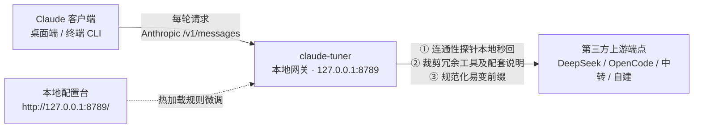

# claude-tuner

<p align="center">
  <strong>专为 Claude Code 与 Claude 桌面端打造的本地优化网关</strong>
  <br />
  前缀缓存稳定化 · 分组工具裁剪与提示词联动 · 本地可视化配置台 · 纯标准库零依赖
</p>

<p align="center">
  
  
  
  
</p>

> **关于这个仓库**：它是从一个私有仓整体导出的**发布产物**，请**不要直接提交 PR**
> —— 下一次发布会整树覆盖，你的改动会消失。问题与建议请开 issue；代码、测试（`tests/`）
> 与文档都在同一棵树里，克隆下来就能读懂它是怎么工作的。

---

## 💡 为什么需要 claude-tuner？

Claude Code 与 Claude 桌面端（3P 模式）默认只认官方模型名称。要接第三方模型（DeepSeek、OpenCode、中转站或自建反代），需要在本地做一层中继：把模型名映射到上游、转发到 Anthropic 兼容端点，同时处理客户端每轮注入的动态上下文。

这层中继主要解决两个问题：

1. **缓存命中率**：客户端会在上下文里反复注入日期、Git 快照这类会变的内容，前缀被打断，缓存就吃不满。网关把这些变动清理掉，让前缀尽量保持稳定。
2. **多余工具**：客户端会固定注入一批低频工具的 Schema 和说明，多数场景用不到，却一直占着上下文。网关按组裁掉，并同步移除对应的提示词段落。

网关只跑在本地（`127.0.0.1:8789`），纯标准库，不改客户端业务逻辑，只做请求前后的整理。

---

## 📊 实测效果

本插件做的是「让前缀恒定」这件**手段**，不承诺任何**结果数字**：命中率取决于你的会话形态、
上游是否支持缓存、客户端版本，换台机器就不是同一个值。想知道自己机器上怎样，跑一条命令：

```bash
python3 ~/.claude/skills/claude-tuner/scripts/stats.py
```

它读本地日志算**你自己的**命中率与上下文规模。本插件任何地方都不写「命中率 99%」这种数：
那是结果，取决于会话形态、上游是否真的支持缓存、客户端版本；我们能负责的只有手段。

---

## 🖥️ 核心特性

- 🔌 **模型接入与映射**  
  客户端只认官方模型代号；网关把代号映射到上游真实模型名，再转发到 Anthropic 兼容端点。
- ⚡️ **前缀缓存稳定化**  
  清理动态日期、Git 快照、模型宣称与计费头；稳定并发工具块的顺序。
- ✂️ **工具裁剪与提示词联动**  
  按组剥离低频工具，并同步移除 System Prompt 里对应的说明段落；核心编程工具受硬编码保护。
- 🔍 **客户端升级跟版自检（抓包分析）**  
  客户端升级后抓一份真实请求，自动核对注入面是否已被现有规则吸收：工具面、System 面、消息面、提示词与工具搭配四面各查一遍，还能和旧版抓包对比，看这次升级到底改了什么。
- 🚀 **探针本地秒回**  
  `max_tokens <= 1` 的连通性探针在本地直接返回，不发往上游、不计费。
- 🎨 **本地配置台**  
  `http://127.0.0.1:8789/`，模型映射、缓存与工具规则、用量统计都在一个页面里；单文件 HTML，无外部依赖。
- 🛡️ **可回滚**  
  单条规则失配只跳过该条；整轮整理失败时回滚到原始请求放行，不影响正常对话。
- 📦 **零依赖**  
  Python 3.11+ 标准库，无需 `pip install`。

---

## 🏗️ 工作原理



---

## ⚡️ 快速开始

### 1. 前置准备
- **操作系统**：
  - **macOS**：长期主力，稳定；
  - **Windows**：**实验性 —— 装之前请先读这一段**。安装器、网关、配置台都是纯 Python，
    CI 在真实的 `windows-latest` 上跑全部单测与安装演练（含 hooks 里那句命令能不能在本机
    解析执行）。但**有一环 CI 永远验不了**：客户端到底会不会去执行 `hooks.json`。这只能在
    真机上装一次才知道，而我们没有 Windows 机器 —— 所以这一环是空的。**能用是运气，
    不能用是常态**，别把它当成 macOS 那条路的等价物。坏了不用自己啃：
    [跑一条诊断命令](#windows-出问题怎么办)把输出贴给我们，或者直接提 PR；
  - **Linux**：无该桌面端，插件逻辑（网关 / 配置台）可用，配置走 XDG。
- **客户端环境**：已安装 [Claude 桌面端](https://claude.com/product/claude-code) 或终端 Claude Code（首次启动会自动生成基础配置目录）。
- **API 凭据**：支持 Anthropic 协议端点的服务商 API Key（如 DeepSeek 官方、OpenCode 或第三方中转服务）。

### 2. 一键安装

**macOS / Linux**（终端执行）：

```bash
curl -fsSL https://raw.githubusercontent.com/ls-open/claude-tuner/main/install.sh | bash
```

**Windows / 全平台通用**（PowerShell / CMD / 终端执行，需 Python 3.11+）：

```bash
python -c "import urllib.request; exec(urllib.request.urlopen('https://raw.githubusercontent.com/ls-open/claude-tuner/main/install.py').read())"
```
或者克隆仓库后直接运行：
```bash
python install.py
```

安装完成后，浏览器将自动弹出本地配置台（`http://127.0.0.1:8789/`）：
1. 在配置页选择或填写服务商接入地址与 API Key；
2. 点击「测试连接」验证端点可用性与网络延迟；
3. 点击「接上模型」区块标题右侧的「保存 N 项」（只有存在未保存改动时才会出现）；
4. **完全退出 Claude 桌面端后重新启动**（需通过顶部菜单栏选择「退出」，非点击红叉）。

**验证是否生效**：

```bash
tail -5 ~/.claude-tuner/logs/gateway.log
```

日志中出现 `"event": "upstream_ok"` 即代表链路通畅。

---

## 🎛️ 本地配置台

浏览器访问 **`http://127.0.0.1:8789/`** 即可管理网关。配置台按九个区块组织：

| 区块 | 管什么 |
| :--- | :--- |
| ① 接上模型 | 服务商预设、Anthropic 协议端点、API Key、连通测试 |
| ② 模型映射 | Claude 代号 → 上游真实模型名、1M 上下文窗口 |
| ③ 上下文缓存 | 缓存保留 1 小时、关闭输入联想、关闭自动压缩，以及空闲压缩 / 预生成摘要 / 思考摘要 / 强制思考四项默认关闭的高级开关 |
| ④ 请求稳定化 | 探针本地拦截、计费头与动态日期清洗、Git 快照剥离、工具与混合消息定序，外加三条可选的防御性提示词精简 |
| ⑤ 工具精简 | 分组开关 + 一键精简整组，工具定义与提示词段落同步剥离 |
| ⑥ 客户端偏好 | 去除 Co-Authored-By 署名、终端 Claude Code 联动、随附技能、客户端定时任务 |
| ⑦ 用量统计 | 缓存命中 / 未命中 / 输出 Token，数字来自上游真实 `usage` 响应，非估算 |
| ⑧ 网关状态 | 本地端点复制、重启网关、日志滚动保留天数 |
| ⑨ 版本与更新 | 当前版本、客户端版本、更新检查 |

保存分两条路：④⑤（以及上游地址、日志保留天数）改完 300 ms 自动保存并给 5 秒撤销；写客户端配置的 ①②③⑥ 才会在区块标题上出现「保存 N 项」。「工具精简」另有整组总开关，避免逐项点选。

### 配置生效机制速查

配置台清晰标注了每一项配置的生效边界：

| 标记 | 写入位置 | 涵盖内容 |
| :--- | :--- | :--- |
| **保存后即生效** | 网关自身配置 | 上游地址、请求稳定化规则、工具精简规则、日志保留天数 |
| **保存后新会话生效** | 客户端设置 / 3P 配置 | 输入联想、自动压缩、高级压缩 / 思考开关、Co-Authored-By、终端联动 |
| **保存后需重启客户端** | 3P 配置 / 桌面偏好 | API Key、上游模型映射、1M 上下文窗口、缓存保留 1 小时、随附技能、定时任务 |

> 若因清除浏览器缓存需要带 Token 的免密登录链接，可在终端运行：
> ```bash
> python3 ~/.claude/skills/claude-tuner/scripts/webui.py --url
> ```

### 真实用量透视

直接解析上游原生返回的 `usage` 数据，展示缓存读取与未命中 Token 的占比、以及工具裁剪剥掉的定义数量；全部取自上游返回值，不做估算。

---

## 🔍 跟版自检（抓包分析）

客户端一升级，注入的提示词与工具表都可能变。升级后按这三步自查一次即可：

```bash
python3 ~/.claude/skills/claude-tuner/scripts/sentinel.py capture on   # 打开抓包
#   去客户端发一条消息（探针请求不会被抓）
python3 ~/.claude/skills/claude-tuner/scripts/sentinel.py audit --last # 四面自检
python3 ~/.claude/skills/claude-tuner/scripts/sentinel.py capture off  # 收工关掉
```

结论全绿即表示这次升级已被现有规则完全吸收，无需动作；有命中会直接指出该补哪条规则。
想跟版对比，`sentinel.py compare <旧抓包> <新抓包>` 会列出工具定义与 System 提示词的具体差异。

抓的是**客户端发来的原始报文**，平时开关是关的；打开后归档到 `~/.claude-tuner/captures/`
（最多保留最近 20 个会话），用完记得关掉。

---

## 💻 终端 Claude Code 联动

安装时默认已打通终端环境。终端中的 `claude` 命令行工具将自动走本地网关转发，共享前缀优化规则与上游模型配置：

```bash
# 验证链路
claude -p "只回复两个字：成功"
```

若需在终端恢复使用 Anthropic 官方订阅账号，只需在配置台取消勾选「终端 Claude Code 同样走本网关」即可。

---

## ❓ 常见问题 (FAQ)

<details>
<summary><strong>Q: 裁剪冗余工具是否会影响代码编写与文件读写？</strong></summary>

不会。核心编程工具（`Read`、`Write`、`Edit`、`Glob`、`Grep`、`Bash` 等）均被收录于底层保护名单中，任何开关组合都无法剥离。可被裁剪的只是联网、桌面界面、会话管理、多智能体协同等外围工具。
</details>

<details>
<summary><strong>Q: 为什么工具裁剪是分组静态开关，而不是按任务动态选择？</strong></summary>

`tools` 位于请求最前面，属于缓存前缀的一部分。按任务每轮动态增删，等于每轮换一次前缀，缓存几乎每轮都要重建。分组开关只在改配置时影响一次，之后前缀稳定下来就能持续命中。

代价是少了按任务粒度做工具检索的灵活性。
</details>

<details>
<summary><strong>Q: 能开客户端的 Tool Search（`toolSearchEnabled`）吗？</strong></summary>

**不能。** Tool Search 是客户端的一次性省 Token 手段：它不再把全部工具说明一次发给模型，
而是先发一个检索入口，模型要用哪个工具再去取哪个。

代价是工具表逐轮变化 —— 而 `tools` 在请求最前面，属于缓存前缀。前缀每轮变一次，缓存就
每轮重建，本项目做的事全部作废。两者只能选一个，这里选缓存：工具一律静态分组裁剪。
</details>

<details>
<summary><strong>Q: 为什么网关要求上游必须支持 Anthropic 协议？</strong></summary>

为了保证性能与行为可控，网关只做请求整理，不做 OpenAI 格式转译。上游需要提供 Anthropic 兼容端点，例如 `https://api.deepseek.com/anthropic`。
</details>

<details>
<summary><strong>Q: 网络搜索（WebSearch / WebFetch）工具到底该开还是该关？</strong></summary>

`WebSearch` 与 `WebFetch` 属于**服务端工具** —— 客户端只负责把工具定义发送出去，真正的检索与抓取动作由**上游服务商**执行。因此，开不开该开关只影响是否占用上下文空间；能否实际生效取决于你的上游模型服务商是否支持该能力。
</details>

<details>
<summary><strong>Q: 为什么安装时默认关闭自动压缩（autoCompactEnabled）？</strong></summary>

压缩会重写整段历史，已有的缓存前缀随之失效，下一次请求要全额重算。安装时默认关闭（③ 的「关闭会话自动压缩」默认勾选）；需要时手动执行 `/compact`。
</details>

<details>
<summary><strong>Q: 网关进程异常退出会导致任务中断吗？</strong></summary>

会。客户端把请求直接发到本地网关，网关进程不在，这一轮就发不出去。

- 网关自身的报文异常会回滚到原始请求放行，不会因为清洗失败而中断；
- 进程真的退出时，**下一次会话开始**客户端 Hook 会把它拉起；但正在进行的这一轮会失败，需要重新发起。
  （桌面端只有 `SessionStart` 会触发，`UserPromptSubmit` 从不触发 —— 别指望「发消息就顺手重启」。）
</details>

<details>
<summary><strong>Q: API Key 与数据安全如何保障？</strong></summary>

网关服务仅严格监听在本地回路地址（`127.0.0.1`）；所有密钥仅存放于本机本地配置中（macOS / Linux 上权限位 `0600`；Windows 没有 POSIX 权限位，靠用户目录自身的 ACL），绝不上报任何外部服务器。日志只记请求元数据（会话、模型、Token、命中、耗时），不记 Prompt 正文。例外是调试用的原始报文归档：默认关闭（`capture_raw_inbound = false`），手动打开后才写到 `~/.claude-tuner/captures/`，最多保留最近 20 个会话，用完应关闭。
</details>

---

## 🪟 Windows 支持现状（以及我们为什么把它标成实验性）

核心代理逻辑与配置台都是纯 Python 跨平台实现，`platform_support.py` 收口了全部系统差异
（探活、终止、文件锁、脱离父进程起子进程、客户端是否在跑）。剩下的是**两条我们证明不了的边**。

**已经验过的**（在真实的 `windows-latest` runner 上，每次提交都跑）：

| 验的东西 | 怎么验的 |
| :--- | :--- |
| 全部单测 | 在 Windows 上真跑（不写条数：它每加一条用例就过期一次，说了等于没说） |
| hooks 的解释器名 | 逐条取解释器，再用真子进程按 exec form 形跑一遍，确认解析得开 |
| 安装器 | `install.py --dry-run` 在 Windows 上走完整条路径 |
| 退出握手 | 写停止标记 → 网关自己退 → 端口关掉，两个平台同一条路 |
| 启动不依赖网络 | 把反向 DNS 卡住 60 秒，网关照样起来（这就是 0.9.0 在 macOS CI 上翻车的那条） |

**hooks 的形态不再是个变量。** 早先 `hooks.json` 用的是 shell form（不带 `args`）：
macOS 交给 `sh -c`，Windows 交给 Git Bash、没有就交给 PowerShell —— 而
`"${CLAUDE_PLUGIN_ROOT}/scripts/manager.py"` 在 PowerShell 里是**它自己的变量语法**，
会展开成空串，命令变成 `python3 "/scripts/manager.py"`，静默失败。
现在改成 **exec form**（`command` + `args`）：任何平台都没有 shell，占位符按普通字符串替换。
**这个失败模式从构造上不再存在**，不需要有台 Windows 机器才能保证。
（改之前用探针实测过：客户端把替换后的路径当成一个参数递进来，真命令执行成功，退出码 0。）

**还没验过的**，按「离用户多近」排：

1. `python3` / `python` / `py` 在真实 Windows 上叫什么——`bootstrap.py align` 会挑本机存在的那个，
   CI 验了解析与执行，但真实机器上的 PATH 只有真机知道。
2. 3P 配置目录在真实 Windows 客户端上是不是 `%APPDATA%\Claude-3p`（我们是按文档推的）。
3. 一个陌生人照着一行命令装，在干净系统上能不能走通（防火墙、代理、杀软）。
4. 企业环境：MITM 证书、代理、组策略。

> 另外两条与平台无关、但值得知道的事实：hooks **只在会话启动时加载一次**（改了要新开会话才生效），
> 而 `UserPromptSubmit` 在桌面端**从未触发过**——别指望「发消息时会顺手把网关拉起来」。

**所以我们的取舍是**：不把没验的东西写成「支持」。Windows 保持实验性，出了问题**由用户
先替我们验一步**，我们把代价压到「跑一条命令、贴一段文字」。

### 网关起不来怎么办（任何平台，不需要任何 AI）

请求本身走本地网关：网关挂了，你连这条消息都发不出去。所以记住这两条命令就够：

```bash
python3 ~/.claude/skills/claude-tuner/scripts/manager.py ensure
python3 ~/.claude/skills/claude-tuner/scripts/bootstrap.py doctor
```

第一条把网关拉起来（macOS/Linux 的路径；Windows 是
`python "%USERPROFILE%\.claude\skills\claude-tuner\scripts\manager.py" ensure`），
第二条给出可贴的诊断信息。**这两条不依赖客户端、不依赖任何模型。**

### Windows 出问题怎么办

先把这一段贴上，它比任何文字描述都有用（**不含任何密钥**，只回答「填了没」）：

```bash
python "%USERPROFILE%\.claude\skills\claude-tuner\scripts\bootstrap.py" doctor
```

它会打印版本、系统、Python、三个解释器在不在、插件目录、hooks 里现在那句命令、
3P 配置路径、网关的 pid 与存活状态、日志最后几行。整段复制到
[issue](https://github.com/ls-open/claude-tuner/issues) 里就行。

**也欢迎直接提 PR。** 平台相关的改动只往一处放（`scripts/platform_support.py`），
其余业务代码里不要再写 `if win32` —— 抄件一多就会出现「页面说客户端没开、manager 说有」。
PR 里请带上：改了什么、在哪个 Windows 版本上验的、`doctor` 的前后输出。

> Linux：没有该桌面端，插件逻辑（网关 / 配置台）可用，配置走 XDG。同样不承诺端到端可用。

---

## 🧹 卸载

如需移除本插件及相关网关组件，执行以下命令即可：

```bash
bash ~/.claude/skills/claude-tuner/install.sh --uninstall
```

该命令会停止本地网关、删除插件目录，并清除安装时写入 `~/.claude/settings.json` 的环境变量与四项省钱键（缓存时长 / 输入联想 / 自动压缩）；改动前的配置备份留在 `~/.claude-tuner/backups/`。3P 推理配置默认保留，要一并清掉可加 `bootstrap.py uninstall --purge-3p`。

---

## 📄 许可证

本项目基于 [MIT License](LICENSE) 开源。
