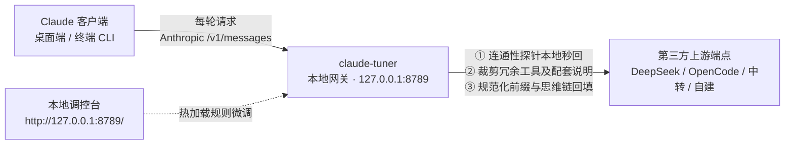

# claude-tuner

<p align="center">
  <strong>专为 Claude Code 与 Claude 桌面端打造的高性能本地优化网关</strong>
  <br />
  前缀缓存稳定化 · 动态工具与提示词联动裁剪 · 本地可视化调控台 · 纯标准库零依赖
</p>

<p align="center">
  
  
  
  
  
</p>

---

## 💡 为什么需要 claude-tuner？

在使用 **Claude Code** 或 **Claude 桌面端（3P 开发者模式）** 接入第三方高性价比模型（DeepSeek、OpenCode、中转站或自建反代）时，**Prompt 缓存命中率直接决定了 API 支出成本**。

以 DeepSeek 为例，缓存命中与未命中的输入价格相差高达 **50 倍**（闲时 ¥0.02 / M Tokens vs 未命中 ¥1.00 / M Tokens）。

然而，官方客户端在多轮交互中会**持续产生非预期的前缀扰动**：
1. **时间戳注入**：每一轮动态注入 `# currentDate` 与当前日期，导致前缀不断漂移；
2. **Git 快照更新**：每次提交代码或切换分支后，在上下文头部插入新的 `gitStatus` 树快照；
3. **思维链剥离**：多轮会话后主动剪掉历史中的 `thinking` 块，造成后续轮次上下文与上游缓存不一致；
4. **并发工具乱序**：并发工具调用的 `tool_result` / `tool_use` 返回顺序随机，破坏字节级确定性；
5. **冗余工具累赘**：强制注入大量低频辅助工具的 Schema 与配套说明，白白挤占固定上下文空间；
6. **高频探针扣费**：频繁发送 `max_tokens <= 1` 的连通性探针，增加网络延迟与无意义计费。

**只要请求前缀差了一个标点，上游便会判定为缓存失效，导致整段历史上下文全额重算。**

`claude-tuner` 作为运行在本地（`127.0.0.1:8789`）的轻量反向代理，**在完全保持业务语义的前提下消除所有前缀扰动**，让每一轮请求的前缀字节保持高度恒定，将 Prompt Cache 命中率稳固在 **99% 以上**。

---

## 📊 实测效果对比

| 接入方案 | 缓存命中率 | 100 万 Token 输入实际花费 (以 DeepSeek 闲时计) | 状态与体验 |
| :--- | :---: | :---: | :--- |
| **接入 claude-tuner** | **99% ~ 100%** | **≈ ¥0.03** | **吃满前缀折扣，探针 0 延迟秒回，上下文纯净** |
| 原生未优化接入 | ~90% - 95% | ≈ ¥0.07 - ¥0.12 | 频繁因日期、Git 变更或工具乱序导致缓存击穿 |
| 完全无缓存状态 | 0% | ¥1.00 | 每轮历史全额计费（费用高出 30~50 倍） |

> **说明**：实际节省幅度取决于上游厂商的缓存机制（TTL / 显存驻留策略）与会话节奏。本网关专注于确保本地发出的请求前缀严格一致。

---

## 🖥️ 核心特性

- ⚡️ **极致的前缀缓存稳定化 (Prefix Stabilization)**  
  物理剥离动态日期、Git 状态快照、模型版本宣称与计费头；对并发工具块进行对称规范化排序；从本地会话记录自动回填被裁剪的思维链（Thinking Restoration）。
- ✂️ **智能工具裁剪与提示词联动 (Surgical Tool Pruning)**  
  按需剥离窗口遥控、设计图同步等低频辅助工具；**不仅裁剪工具定义，还会同步移除 System Prompt 中对应的引导段落**，彻底杜绝模型被引导至不存在的工具。核心编程工具（文件读写、编辑、命令执行）受底层硬编码保护，绝不误伤。
- 🧹 **上下文深度优化（可选）**  
  在纯代码等高阶优化挡位中，支持按需精简客户端注入的安全限制指引与操作确认等次级规则段落，减少非必要指令对模型注意力的干扰，让长上下文保持精炼纯净。
- 🚀 **连通性探针本地秒回 (Zero-Cost Probe Interception)**  
  精准拦截客户端轻量级心跳与探针请求（`max_tokens <= 1`），本地零延迟秒回，不发往上游、不占网络、不计费。
- 🎨 **自包含本地可视化配置台 (Embedded WebUI)**  
  访问 `http://127.0.0.1:8789/` 即可通过自包含 Web 控制台完成一键连通性测速、模型映射、规则微调与真实用量透视。单文件 HTML、零 CDN 依赖、极严 CSP 防护。
- 🛡️ **严格的降级容错机制 (Zero-Breakage Guarantee)**  
  定位为纯优化层。遇到任何异常自动无损回滚到原始报文放行，**宁可少优化，绝不中断正常业务流**。
- 📦 **零第三方依赖 (Zero Dependencies)**  
  仅基于 Python 3.11+ 标准库构建，无需 `pip install`，无环境冲突，支持一键无痕卸载。

---

## 🏗️ 工作原理



---

## ⚡️ 快速开始

### 1. 前置准备
- **操作系统**：macOS（Windows 正在规划适配中）。
- **客户端环境**：已安装 [Claude 桌面端](https://claude.com/product/claude-code) 并**至少启动过一次**（首次启动会自动生成基础配置目录）。
- **API 凭据**：支持 Anthropic 协议端点的服务商 API Key（如 DeepSeek 官方、OpenCode 或第三方中转服务）。

### 2. 一键安装

在终端执行以下命令：

```bash
curl -fsSL https://raw.githubusercontent.com/ls-open/claude-tuner/main/install.sh | bash
```

安装完成后，浏览器将自动弹出本地配置台（`http://127.0.0.1:8789/`）：
1. 在配置页选择或填写服务商接入地址与 API Key；
2. 点击「测试连接」验证端点可用性与网络延迟；
3. 点击「接上模型」区块标题右侧的「保存 N 项」（只有存在未保存改动时才会出现）；
4. **完全退出 Claude 桌面端后重新启动**（需通过顶部菜单栏选择「退出」，非点击红叉）。

**验证是否生效**：

```bash
tail -5 ~/.claude-tuner/logs/gateway.log
```

日志中出现 `"event": "upstream_ok"` 即代表链路通畅。

---

## 🎛️ 本地调控台

浏览器访问 **`http://127.0.0.1:8789/`** 即可管理网关。调控台支持三组典型场景预设：

| 预设挡位 | 适用场景 | 核心策略 |
| :--- | :--- | :--- |
| **零干预档** | 极致保真 / 故障对比 | 原生透传所有工具与上下文，仅保留探针本地拦截 |
| **日常开发均衡档（默认）** | 绝大多数日常开发 | 稳定前缀、自动回填思维链、精简次要辅助工具及引导词 |
| **纯代码极限档** | 追求极限性价比与长上下文 | 进一步剔除次级工具与防御性提示词，最大化压缩 Prompt 体积 |

### 配置生效机制速查

调控台清晰标注了每一项配置的生效边界：

| 标记 | 写入位置 | 涵盖内容 |
| :--- | :--- | :--- |
| **立即生效** | 网关自身配置 | 前缀清洗、缓存稳定化、工具精简规则 |
| **新会话生效** | 客户端设置 / 3P 配置 | 缓存保留时长、输入联想、终端联动、定时任务 |
| **需重启客户端** | 3P 配置 / 桌面偏好 | 上游模型映射、1M 上下文窗口、客户端自带能力 |

> 若因清除浏览器缓存需要带 Token 的免密登录链接，可在终端运行：
> ```bash
> python3 ~/.claude/skills/claude-tuner/scripts/webui.py --url
> ```

### 真实用量透视

直接解析上游原生返回的 `usage` 数据，清晰展示缓存命中率、命中/未命中的 Token 分类、以及工具裁剪节省的定义数量，提供客观、无修饰的用量反馈。

---

## 💻 终端 Claude Code 联动

安装时默认已打通终端环境。终端中的 `claude` 命令行工具将自动走本地网关转发，共享前缀优化规则与上游模型配置：

```bash
# 验证链路
claude -p "只回复两个字：成功"
```

若需在终端恢复使用 Anthropic 官方订阅账号，只需在配置台取消勾选「终端 Claude Code 同样走本网关」即可。

---

## ❓ 常见问题 (FAQ)

<details>
<summary><strong>Q: 裁剪冗余工具是否会影响代码编写与文件读写？</strong></summary>

**绝对不会**。核心编程工具（`Read`、`Write`、`Edit`、`Glob`、`Grep`、`Bash` 等）均被收录于底层保护名单中，任何配置挡位均无法剥离。可被裁剪的仅为窗口遥控、设计图同步、会话导出会话管理等辅助工具。
</details>

<details>
<summary><strong>Q: 为什么网关要求上游必须支持 Anthropic 协议？</strong></summary>

为了保证极致的性能、确定性的字节流稳定性与零破坏风险，网关专注于**前缀清洗与优化**，不做 OpenAI 格式转译。若使用 DeepSeek 等兼容服务，请使用其 Anthropic 兼容端点（如 `https://api.deepseek.com/anthropic`）。
</details>

<details>
<summary><strong>Q: 网络搜索（WebSearch / WebFetch）工具到底该开还是该关？</strong></summary>

`WebSearch` 与 `WebFetch` 属于**服务端工具** —— 客户端只负责把工具定义发送出去，真正的检索与抓取动作由**上游服务商**执行。因此，开不开该开关只影响是否占用上下文空间；能否实际生效取决于你的上游模型服务商是否支持该能力。
</details>

<details>
<summary><strong>Q: 为什么调控台默认建议关闭自动压缩（autoCompactEnabled）？</strong></summary>

客户端的自动压缩机制会在达到上下文阈值时自主触发一次历史汇总。**然而，压缩会彻底改变历史上下文，导致之前的缓存前缀全部失效并全额重算一次**。调控台建议关闭自动压缩，改为在必要时由用户手动执行 `/compact`，从而将缓存控制权交还给开发者。
</details>

<details>
<summary><strong>Q: 网关进程异常退出会导致任务中断吗？</strong></summary>

客户端每次发起会话与用户提交消息前，内置的钩子会自动探测网关进程存活性并按需静默拉起；且网关即便遇到网络故障或极端报文也会自动降级回滚至原始报文放行，保障正常开发流程不被阻断。
</details>

<details>
<summary><strong>Q: API Key 与数据安全如何保障？</strong></summary>

网关服务仅严格监听在本地回路地址（`127.0.0.1`）；所有密钥仅存放于本机本地配置中（权限严格限定为 `0600`），绝不上报任何外部服务器，不记录用户敏感 Prompt 内容。
</details>

---

## 🪟 Windows / Linux 适配路线

目前核心代理逻辑与配置台均为纯 Python 跨平台实现。由于部分本地路径配置（如桌面端配置文件位置、LaunchServices 钩子）针对 macOS 做了针对性适配，欢迎社区贡献 Windows / Linux 的适配支持。

---

## 🧹 卸载

如需移除本插件及相关网关组件，执行以下命令即可：

```bash
bash ~/.claude/skills/claude-tuner/install.sh --uninstall
```

该命令将自动清理环境变量与本地守护进程，并安全保留你的原始配置文件备份。

---

## 📄 许可证

本项目基于 [MIT License](LICENSE) 开源。
