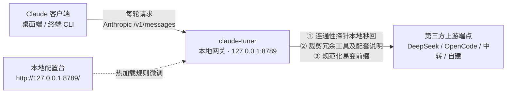

# claude-tuner

<p align="center">
  <strong>专为 Claude Code 与 Claude 桌面端打造的本地优化网关</strong>
  <br />
  前缀缓存稳定化 · 分组工具裁剪与提示词联动 · 本地可视化配置台 · 纯标准库零依赖
</p>

<p align="center">
  
  
  
  
</p>

> **关于这个仓库**：代码、测试（`tests/`）与文档都在同一棵树里，克隆下来就能读懂它是怎么
> 工作的。**issue 与 PR 都欢迎** —— 提 PR 前跑一次
> `python3 -m unittest discover -s tests -p "test_*.py"`，全绿再提交。

---

## 💡 为什么需要 claude-tuner？

Claude Code 与 Claude 桌面端（3P 模式）默认只认官方模型名称。要接第三方模型（DeepSeek、OpenCode、中转站或自建反代），需要在本地做一层中继：把模型名映射到上游、转发到 Anthropic 兼容端点，同时处理客户端每轮注入的动态上下文。

这层中继主要解决两个问题：

1. **缓存命中率**：客户端会在上下文里反复注入日期、Git 快照这类会变的内容，前缀被打断，缓存就吃不满。网关把这些变动清理掉，让前缀尽量保持稳定。
2. **多余工具**：客户端会固定注入一批低频工具的 Schema 和说明，多数场景用不到，却一直占着上下文。网关按组裁掉，并同步移除对应的提示词段落。

网关只跑在本地（`127.0.0.1:8789`），纯标准库，不改客户端业务逻辑，只做请求前后的整理。

> **不承诺命中率数字。** 省多少取决于你的会话形态、上游是否真的支持缓存、客户端版本。
> 我们负责的只有手段——让前缀别变；想知道自己机器上怎样，跑
> `python3 ~/.claude/skills/claude-tuner/scripts/stats.py` 看本地日志算出来的值。

---

## 🖥️ 核心特性

- 🔌 **模型接入与映射**  
  客户端只认官方模型代号；网关把代号映射到上游真实模型名，再转发到 Anthropic 兼容端点。
- ⚡️ **前缀缓存稳定化**  
  清理动态日期、Git 快照、模型宣称与计费头；稳定并发工具块的顺序。
- ✂️ **工具裁剪与提示词联动**  
  按组剥离低频工具，并同步移除 System Prompt 里对应的说明段落；核心编程工具受硬编码保护。
- 🔍 **客户端升级跟版自检（抓包分析）**  
  客户端升级后抓一份真实请求，自动核对注入面是否已被现有规则吸收：工具面、System 面、消息面、提示词与工具搭配四面各查一遍，还能和旧版抓包对比，看这次升级到底改了什么。
- 🚀 **探针本地秒回**  
  `max_tokens <= 1` 的连通性探针在本地直接返回，不发往上游、不计费。
- 🎨 **本地配置台**  
  `http://127.0.0.1:8789/`，模型映射、缓存与工具规则、用量统计都在一个页面里；单文件 HTML，无外部依赖。
- 🛡️ **可回滚**  
  单条规则失配只跳过该条；整轮整理失败时回滚到原始请求放行，不影响正常对话。
- 📦 **零依赖**  
  Python 3.11+ 标准库，无需 `pip install`。

---

## 🏗️ 工作原理



---

## ⚡️ 快速开始

### 1. 前置准备
- **操作系统**：
  - **macOS**：主平台，稳定。
  - **Windows**：**实验性**——代码已在 Windows CI 上跑通，但还没有真机验证。遇到问题请带上
    [诊断输出](docs/details.md#windows) 提 issue。
  - **Linux**：没有该桌面端；插件逻辑（网关、配置台）可用，配置走 XDG。
- **客户端环境**：已安装 [Claude 桌面端](https://claude.com/product/claude-code) 或终端 Claude Code（首次启动会自动生成基础配置目录）。
- **API 凭据**：支持 Anthropic 协议端点的服务商 API Key（如 DeepSeek 官方、OpenCode 或第三方中转服务）。

### 2. 一键安装

**macOS / Linux**（终端执行）：

```bash
curl -fsSL https://raw.githubusercontent.com/ls-open/claude-tuner/main/install.sh | bash
```

**Windows / 全平台通用**（PowerShell / CMD / 终端执行，需 Python 3.11+）：

```bash
python -c "import urllib.request; exec(urllib.request.urlopen('https://raw.githubusercontent.com/ls-open/claude-tuner/main/install.py').read())"
```
或者克隆仓库后直接运行：
```bash
python install.py
```

安装完成后，浏览器将自动弹出本地配置台（`http://127.0.0.1:8789/`）：
1. 在配置页选择或填写服务商接入地址与 API Key；
2. 点击「测试连接」验证端点可用性与网络延迟；
3. 点击「接上模型」区块标题右侧的「保存 N 项」（只有存在未保存改动时才会出现）；
4. **完全退出 Claude 桌面端后重新启动**（需通过顶部菜单栏选择「退出」，非点击红叉）。

**验证是否生效**：

在配置台的「⑧ 网关状态」里看，或翻 `~/.claude-tuner/logs/` 下最新的
`gateway.<日期>.log`：出现 `"event": "upstream_ok"` 就说明链路通了。

---

> 终端联动、Windows、抓包自检、网关起不来怎么办：[docs/details.md](docs/details.md)。

## 🎛️ 本地配置台

浏览器访问 **`http://127.0.0.1:8789/`** 即可管理网关。配置台按九个区块组织：

| 区块 | 管什么 |
| :--- | :--- |
| ① 接上模型 | 服务商预设、Anthropic 协议端点、API Key、连通测试 |
| ② 模型映射 | Claude 代号 → 上游真实模型名、1M 上下文窗口 |
| ③ 上下文缓存 | 缓存保留 1 小时、关闭输入联想、关闭自动压缩，以及空闲压缩 / 预生成摘要 / 思考摘要 / 强制思考四项默认关闭的高级开关 |
| ④ 请求稳定化 | 探针本地拦截、计费头与动态日期清洗、Git 快照剥离、工具与混合消息定序，外加三条可选的防御性提示词精简 |
| ⑤ 工具精简 | 分组开关 + 一键精简整组，工具定义与提示词段落同步剥离 |
| ⑥ 客户端偏好 | 去除 Co-Authored-By 署名、终端 Claude Code 联动、随附技能、客户端定时任务 |
| ⑦ 用量统计 | 缓存命中 / 未命中 / 输出 Token，数字来自上游真实 `usage` 响应，非估算 |
| ⑧ 网关状态 | 本地端点复制、重启网关、日志滚动保留天数 |
| ⑨ 版本与更新 | 当前版本、客户端版本、更新检查 |

保存分两条路：④⑤（以及上游地址、日志保留天数）改完 300 ms 自动保存并给 5 秒撤销；写客户端配置的 ①②③⑥ 才会在区块标题上出现「保存 N 项」。「工具精简」另有整组总开关，避免逐项点选。

## ❓ 常见问题 (FAQ)

<details>
<summary><strong>Q: 裁剪冗余工具是否会影响代码编写与文件读写？</strong></summary>

不会。核心编程工具（`Read`、`Write`、`Edit`、`Glob`、`Grep`、`Bash` 等）均被收录于底层保护名单中，任何开关组合都无法剥离。可被裁剪的只是联网、桌面界面、会话管理、多智能体协同等外围工具。
</details>

<details>
<summary><strong>Q: 为什么工具是静态分组裁剪，而不是按任务动态挑（包括 Tool Search）？</strong></summary>

因为 `tools` 在请求最前面，是缓存前缀的一部分。按任务每轮增删、或用客户端的 Tool Search
先检索再取用，等于**每轮换一次前缀**，缓存几乎每轮重建 —— 本项目做的事就全部作废。
所以工具一律静态分组：只在改配置时变一次，之后前缀稳定、持续命中。代价是少了按任务粒度的灵活。

</details>

<details>
<summary><strong>Q: 为什么网关要求上游必须支持 Anthropic 协议？</strong></summary>

为了保证性能与行为可控，网关只做请求整理，不做 OpenAI 格式转译。上游需要提供 Anthropic 兼容端点，例如 `https://api.deepseek.com/anthropic`。
</details>

<details>
<summary><strong>Q: 网络搜索（WebSearch / WebFetch）工具到底该开还是该关？</strong></summary>

`WebSearch` 与 `WebFetch` 属于**服务端工具** —— 客户端只负责把工具定义发送出去，真正的检索与抓取动作由**上游服务商**执行。因此，开不开该开关只影响是否占用上下文空间；能否实际生效取决于你的上游模型服务商是否支持该能力。
</details>

<details>
<summary><strong>Q: 为什么安装时默认关闭自动压缩（autoCompactEnabled）？</strong></summary>

压缩会重写整段历史，已有的缓存前缀随之失效，下一次请求要全额重算。安装时默认关闭（③ 的「关闭会话自动压缩」默认勾选）；需要时手动执行 `/compact`。
</details>

<details>
<summary><strong>Q: 网关进程异常退出会导致任务中断吗？</strong></summary>

会。客户端把请求直接发到本地网关，网关进程不在，这一轮就发不出去。

- 网关自身的报文异常会回滚到原始请求放行，不会因为清洗失败而中断；
- 进程真的退出时，**下一次会话开始**客户端 Hook 会把它拉起；但正在进行的这一轮会失败，需要重新发起。
  （桌面端只有 `SessionStart` 会触发，`UserPromptSubmit` 从不触发 —— 别指望「发消息就顺手重启」。）
</details>

<details>
<summary><strong>Q: API Key 与数据安全如何保障？</strong></summary>

网关服务仅严格监听在本地回路地址（`127.0.0.1`）；所有密钥仅存放于本机本地配置中（macOS / Linux 上权限位 `0600`；Windows 没有 POSIX 权限位，靠用户目录自身的 ACL），绝不上报任何外部服务器。日志只记请求元数据（会话、模型、Token、命中、耗时），不记 Prompt 正文。例外是调试用的原始报文归档：默认关闭（`capture_raw_inbound = false`），手动打开后才写到 `~/.claude-tuner/captures/`，最多保留最近 20 个会话，用完应关闭。
</details>

---

## 🧹 卸载

如需移除本插件及相关网关组件，执行以下命令即可：

```bash
bash ~/.claude/skills/claude-tuner/install.sh --uninstall      # macOS / Linux
python "%USERPROFILE%\.claude\skills\claude-tuner\install.py" --uninstall   # Windows
```

该命令会停止本地网关、删除插件目录，并清除安装时写入 `~/.claude/settings.json` 的环境变量与四项省钱键（缓存时长 / 输入联想 / 自动压缩）；改动前的配置备份留在 `~/.claude-tuner/backups/`。3P 推理配置默认保留，要一并清掉可加 `bootstrap.py uninstall --purge-3p`。

---

## 📄 许可证

本项目基于 [MIT License](LICENSE) 开源。
