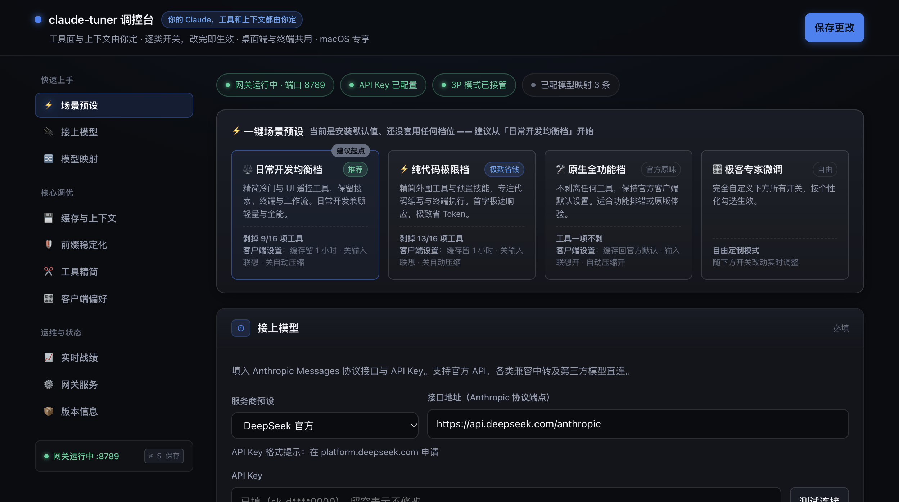
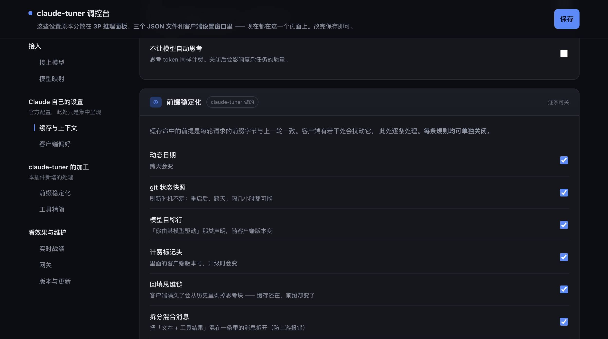
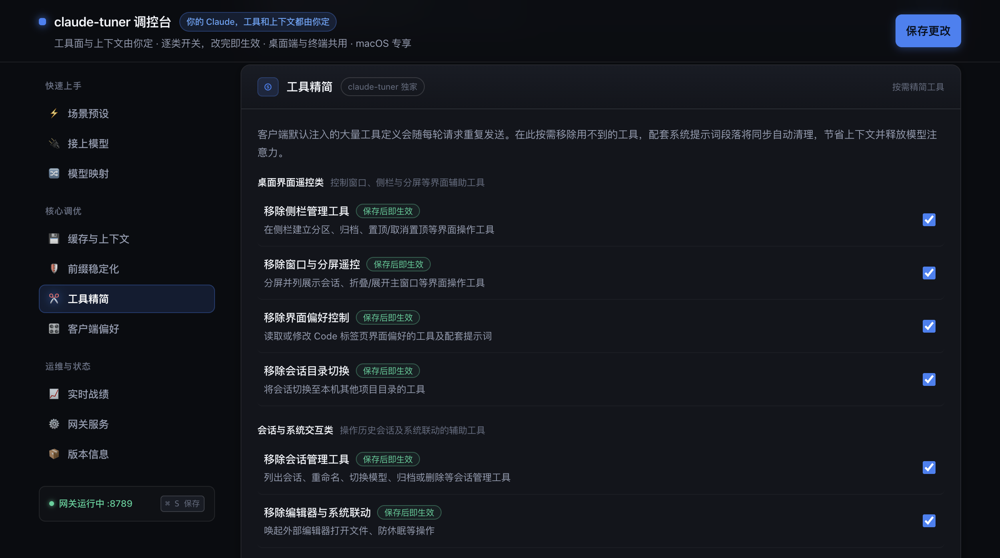
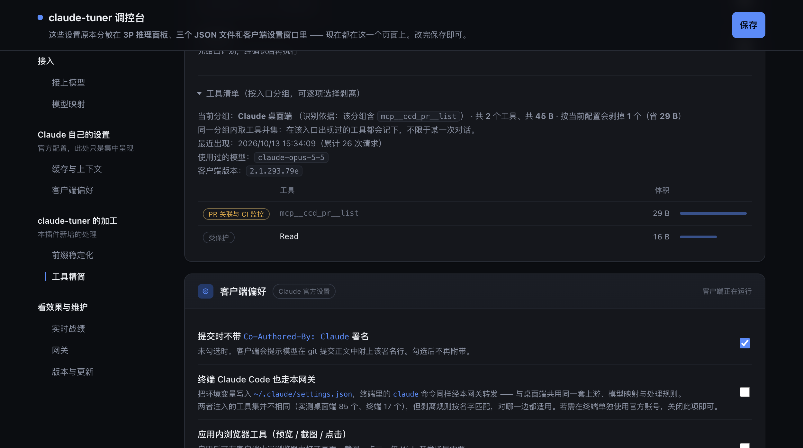
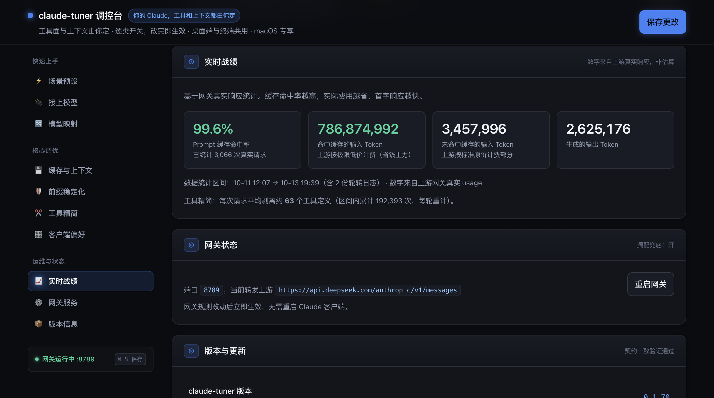

# claude-tuner

> **你的 Claude，你自己做主。**

Claude 客户端的设置散落在好几个地方 —— 3P 推理面板、三个 JSON 文件、应用内的设置窗口。
这个项目把它们收进**一个网页**，并做两件事：

- **想接哪儿就接哪儿** —— 第三方模型、官方模型中转站、自建代理，填个地址和 Key 就行；
- **想留什么就留什么** —— 每轮请求都带着的那一堆工具定义，用不上的清掉、要用时加回来；
  会让缓存失效的那些易变内容，也一并处理掉。

```bash
curl -fsSL https://raw.githubusercontent.com/OWNER/claude-tuner/main/install.sh | bash
```

装完浏览器自动打开配置页，填一个 API Key 就能用 —— 模型名、接口地址、那一堆环境变量都不用你操心。



> **第一版只支持 macOS。** Windows 需要改三处平台相关的代码（文件锁、查进程、配置目录），还没做。

---

## 为什么需要它

DeepSeek 官方对**命中缓存**的 token 收 `$0.003 / 1M`，没命中收 `$0.15 / 1M` —— **50 倍**。
一次长会话的上下文轻松到 10 万~30 万 token，命中与不命中的差价就是账单的大头。

能不能命中，取决于**每一轮请求的前缀字节是不是和上一轮完全一致**。客户端有几处会扰动这个前缀，实测下来分两类：

**不定时变的 —— 平时稳定，但说不准什么时候变一次：**

- **客户端会在一段时间不用之后，从历史消息里剥掉思维链。** 这是最值钱也最隐蔽的一条：DeepSeek 的缓存**能活到约一天**，你隔十几个小时回来接着聊，缓存本来还在 —— 但思维链已经被剥掉了，前缀字节全变，那份还活着的缓存白丢。我们按会话记录把思维链原样补回去。顺带，思维链是模型推理过程的一部分，补回去对答案质量也有好处 —— 否则官方何必给你这份数据。
- **当天日期**：跨天必变。
- **仓库 git 快照**：不定时刷新（重启后、跨天、隔几个小时都可能）。
- **计费头里的客户端版本号**：客户端升级时变。

后三条在一个会话里通常**写一次就不动**（实测连问三轮一字未变），所以剥掉它们主要是在**省 token**，顺带把这种「说不准什么时候变」的不确定性一起去掉。

**每轮都在变的 —— 直接毁缓存：**

- 为输入框那行灰色联想提示，**每轮重发整场对话**（实测 29~57 万 token 一次）；
- 并发工具调用的返回顺序不定。

本项目在本地起一个网关，把这些扰动一条条处理掉。**每一条都是独立开关** —— 哪条对你的用法不合适，关掉就是。

> 这些规则是照着客户端**当前版本**的注入行为写的，不是通用魔法。客户端升级后注入面可能变，规则要跟着更新 —— 仓库里带了一个探针（`tools/probe_client.py`），能把「客户端这次到底发了什么」量出来，不用靠猜。

> **不承诺命中率。** 能省多少取决于上游的缓存有效期与你自己的使用节奏，两头都不是这个项目能定的。它保证的只是「让前缀尽可能保持字节恒定」这个手段。
>
> **它是一个纯优化。** 网关挂了顶多掉缓存、账单变贵，功能不中断。

---

## 安装

### 一条命令

```bash
curl -fsSL https://raw.githubusercontent.com/OWNER/claude-tuner/main/install.sh | bash
```

它会问你一次 API Key（也可以直接回车跳过，稍后在配置页里填），然后自动打开配置页。

装完**必须完全退出 Claude 再重新打开**（不是关窗口，是菜单里的「退出」）—— 3P 的地址、Key、模型映射都只在客户端启动时读一次。

### 国内网络连不上 GitHub 时

安装脚本内部会依次重试几条通道，全不通的话它会明确告诉你。这时走这两条之一：

**下载 zip：** 去仓库页面点 `Code → Download ZIP`，解压后在里面跑：

```bash
bash install.sh
```

**让 AI 帮你装：** 把下面这段粘给任意 AI Agent（Claude Code、Cursor 等）：

> 请帮我安装 claude-tuner：先 `git clone https://github.com/OWNER/claude-tuner` 到任意目录，然后在那个目录里执行 `bash install.sh`，把输出完整贴给我。

### 装完先验证一下

在 Claude 里随便发一条消息，然后看网关日志：

```bash
tail -5 ~/.claude-tuner/logs/gateway.log
```

看到 `"event": "upstream_ok"` 就是通了。没通的话看下一节。

---

## 配置页

安装完会自动打开。地址是 `http://127.0.0.1:8789/`（端口可能不同，用下面这条命令拿回带 token 的完整链接）：

```bash
python3 ~/.claude/skills/claude-tuner/scripts/webui.py --url
```

左侧分四组，前两组性质不同，一眼可分：**「Claude 自己的设置」是官方本来就有的，我们只是集中呈现；「claude-tuner 的加工」是这个插件新增的处理。**

### 接入

**① 接上模型** —— 选服务商（DeepSeek 官方 / OpenCode Zen 充值制 / OpenCode Go 套餐制 / 官方模型中转站 / 自定义），填 API Key。
两个按钮：**测试连接**（真实打一次上游，通不通、耗时多少、上游回了什么都直接显示）、**拉取上游模型列表**（把这家真实支持的模型名拉回来，省得手打）。

**② 模型映射** —— 左边是给 Claude 看的**代号**，右边是**真正发给上游的模型名**。

- 代号必须是 Claude 认识的（客户端靠它决定用哪套提示词与思考预算）。默认只配最新的两个 `Opus 5.5` / `Sonnet 5.5`；想用别的，下拉里有客户端支持的全部 14 个。
- 右边必须**与上游接受的模型名逐字一致，大小写敏感** —— 填错就是上游 404。建议用「拉取上游模型列表」选，别手打。
- 最右边那列 **1M**：逐模型勾选，表示该模型按 100 万 token 的上下文窗口使用。它只决定**客户端**如何计算窗口（多久触发一次自动压缩），与上游是否支持 1M 无关，所以按模型分开设。

### Claude 自己的设置（官方配置，此处集中呈现）

**③ 缓存与上下文** —— 缓存有效期、输入框联想、自动压缩，以及几项更激进的行为开关。**默认值即推荐值**，一般不用动。

**⑥ 客户端偏好** —— 提交时是否附带 `Co-Authored-By: Claude` 署名；终端 Claude Code 是否也走本网关；应用内浏览器工具是否启用。

### claude-tuner 的加工（本插件新增）

**④ 前缀稳定化** —— 逐条处理客户端注入的、会让缓存前缀变化的内容。每条都是独立开关。



**⑤ 工具精简** —— 每一类工具都会在每轮请求里占用一份静态上下文，关掉一类省一类。关闭某一类时，**与它配套的系统提示词段落会一并恢复**，工具与提示词始终同步。



下面还有一个可展开的**工具清单** —— 网关在真实请求里看到什么就列什么，连每一项占多少都称出来。预设的类别是粗的，哪个用不上只有你自己知道，这里可以逐个勾选。

清单按**入口**分组（桌面端 / 终端 / 协作模式，档内取并集），因为不同入口注入的工具集差别很大 —— 实测同一台机器上桌面端 85 个、终端 17 个。分组依据取自计费头里的 `cc_entrypoint`，是客户端自己的声明，不是猜的。



> **有一批工具任何配置都剥不掉**（Bash / Read / Write / Edit / Glob / Grep / Agent / Skill 等）。
> 剥掉它们不是省钱，是让会话没法干活 —— 而且症状很怪：模型说要用某个工具，工具却不在列表里。

### 看效果与维护

**⑦ 实时战绩** —— 命中率、命中与未命中的 token 数、工具精简累计剥掉了多少。**数字来自上游每次响应里的 `usage`**，是上游自己报的，不是我们的估算。



**⑧ 网关** —— 端口、当前上游、重启按钮。

**⑨ 版本与更新** —— 版本对照与一键更新。

改完点保存，页面会告诉你**这次改动需要重启客户端，还是只开个新会话就够**。

---

## 终端 Claude Code

默认安装时已经接好了：网关与桌面端共用一条链路，CLI 那边只是往 `~/.claude/settings.json` 写一组环境变量（指向本机网关，不是直连上游）。

```bash
claude -p "只回复两个字：成功"
```

能回就说明通了。想单独用官方账号跑 CLI，在配置页把「终端 Claude Code 也走本网关」关掉即可 —— 关的时候只会删掉本项目写的那几个键，你自己加的环境变量不受影响。

---

## 它做了什么

| | |
|---|---|
| **清洗客户端注入的易变内容** | 动态日期、`gitStatus` 快照、模型自称行、计费头；回填被客户端剥离的思维链；拆分混合的 user 消息 |
| **消除客户端的行为抖动** | 并发 `tool_use` / `tool_result` 按 id 排序；剔除清洗后变空的残余消息 |
| **砍掉死重** | 把用不到的桌面端工具按类别关掉（每一类都占一份静态上下文，关掉省的是每轮的钱）；连通性探针本地秒回，不上云、不扣费 |
| **不改语义** | 原生 `role: "system"` 原样透传；主对话与子代理分开打标、分开统计 |

> 工具精简关掉的那些**不是"用不了"**，是默认用不上或另有替代：比如原生联网工具在本项目里由自带的联网技能顶上，桌面端的侧栏遥控、终端面板、Notebook 编辑等对纯编码场景是死重。**每一类都能在配置页单独打开**，按自己的用法调。

**随时能看到省了多少：**

```bash
python3 ~/.claude/skills/claude-tuner/scripts/stats.py
```

它只读官方对话底稿与网关日志，打印当前会话的缓存命中率、上下文规模、主对话与子代理的调用次数。

---

## 常见问题

**装完没生效？**
99% 是没重启客户端。必须**完全退出**再打开 —— 关窗口不算。另外确认 3P 是不是真的开着：配置页顶部那排状态灯会告诉你。

**它建议关掉自动压缩，但 DeepSeek 官方文档建议设 `CLAUDE_CODE_AUTO_COMPACT_WINDOW`，听谁的？**
两边要的东西不同。自动压缩会在上下文快满时**重写历史消息**，前缀一变，这一整场的缓存就全丢了；官方那个变量是给「用官方客户端直连」的场景做保护。用本项目的网关时，上下文管理交给上游的 1M 窗口，压缩反而更贵。想要官方那套行为，把配置页里「自动压缩」重新打开即可。

**3P 设置面板里显示的是 `127.0.0.1:8789`，不是我的服务商地址？**
这是对的，故意的。3P 面板填真实地址 + 等插件改写的那套两段式流程，会导致「改完保存还得再手动重启一次客户端」才生效。本项目一开始就把 3P 指向本地网关、把真实上游记在网关自己的配置里，改上游统一在配置页做，那次多余的两次重启就不存在了。

**为什么只推荐配两个模型代号？**
客户端会按代号给不同的提示词与思考预算，代号的"代差"就是提示词的代差。配最新的两个最省事。别的代号也能用，只是未必拿到最新的那套提示词。

**账单里突然出现几万 token 的调用？**
多半是客户端自己派生的**子代理**（后台审查代码之类的），它的上下文比主对话小一个数量级但不等于小。网关会把它按 `subagent` 单独打标，日志和统计里与主对话分得开，不是漏算。

**拉出来的模型列表里有选不了的模型？**
模型列表是这家支持的全部模型，**不带协议信息** —— 「列表里有」不等于「这条路发得出去」。有些模型只支持 OpenAI 协议，通过本网关（Anthropic 协议）调用会失败。所以：**选完点一下「测试连接」**，它会把你映射表里用到的每个上游模型真打一次，哪个走不通直接告诉你。

**点了 `Rewind to here`（回退）之后第一轮特别贵？**
回退不是原地删行，客户端会分叉出新的 `session_id`，上游因此被路由到新节点、缓存要重建。网关会在这时自动补回历史思维链，所以**只有第一轮重算一次**，下一轮起就恢复命中。只点「取消发送」不点回退的话不会换 session id，不丢缓存。

**能用在别的客户端上吗？**
网关是标准的 Anthropic 协议端点，任何能配置 `ANTHROPIC_BASE_URL` 的东西都能接。但线上这条路上的前缀稳定化规则都是针对 Claude 客户端注入的那几种模式写的，换个客户端效果不一定。

---

## 卸载

```bash
bash ~/.claude/skills/claude-tuner/install.sh --uninstall
```

它只收回本项目写的东西：停网关、撤掉 `~/.claude/settings.json` 里那几个键、删插件目录。
**3P 推理配置不动** —— 那是客户端的资产，我们只是往里填了字段。要一起清掉：

```bash
python3 ~/.claude/skills/claude-tuner/scripts/bootstrap.py uninstall --purge-3p
```

改动前的备份都在 `~/.claude-tuner/backups/3p/`，随时可以自己翻回去。

---

## 从源码安装（开发用）

```bash
git clone https://github.com/OWNER/claude-tuner
cd claude-tuner
bash install.sh --dry-run   # 先看一眼会动什么，一个文件都不会写
bash install.sh             # 真装
```

改了代码之后，重新跑一次 `bash install.sh --force` 即可；只改网关规则的话不用重启客户端。

```
install.sh          安装/卸载入口（只做调度与前置检查）
scripts/bootstrap.py 写好客户端状态：开 3P、建推理配置、接 CLI
scripts/webui.py    配置页的 HTTP 层（挂在网关自己的端口上）
webui/index.html    配置页（单文件、零依赖、离线可用）
scripts/gateway.py  本地网关本体
scripts/config_ops.py 配置合并/校验的纯函数层
```

---

## 许可证

MIT，见 [LICENSE](LICENSE)。
