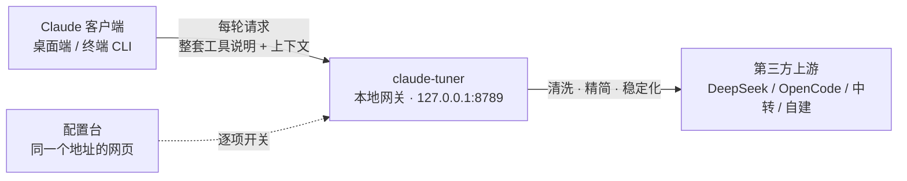
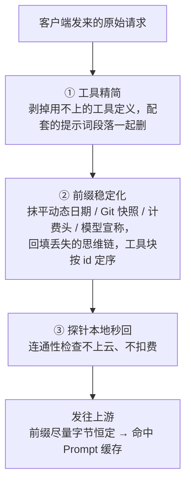

# claude-tuner

**你的 Claude，工具和上下文都由你定。**

接第三方模型（DeepSeek / OpenCode / 中转站 / 自建反代）时，让每一轮请求的**前缀尽量字节恒定** ——
省掉每轮都在重复发送的固定开销、命中上游缓存：账单更小、首字更快。

[安装](#安装) · [它改了什么](#它到底改了什么) · [配置台](#配置台) · [常见问题](#常见问题)



```bash
curl -fsSL https://raw.githubusercontent.com/ls-open/claude-tuner/main/install.sh | bash
```

装完浏览器会自动弹出配置台，填一个 API Key 就能用 —— **需要一个 Key（桌面端 3P / 开发者接入
模式）**，官方 Key、第三方模型、中转站、自建反代都行。其余边界见[装之前先确认](#装之前先确认)。

## 亮点

- **工具面由你定** —— 按功能分组开关，关一类省一类；读写 / 执行 / 检索这些核心工具锁死剥不掉，
  不在名单里的（含客户端升级新增的）一律原样透传。
- **前缀尽量字节恒定** —— 抹平每轮注入的动态日期、Git 快照、计费头、模型宣称，回填丢失的思维链，
  并发工具块定序。上游按前缀字节命中缓存，这几样每轮都在咬你。
- **一个网页搞定上游** —— 填 Key、一键拉模型列表、真机逐个测连通；客户端选择器直接读你的映射。
- **装得干净、退得干净** —— 一条命令、零第三方依赖；卸载一键收回，改动有备份。

> **我们不重做客户端，只把「哪些生效」交给你。** 客户端本身是扎实的，网关只是在它和上游之间
> 加一层你能调的中间层：规则逐条可关，关掉就退回客户端原样。

---

## 它到底改了什么

一条请求进到网关，会走这三步：



### ① 工具面：每轮都在重复发送的固定开销

客户端会把**每个可用工具**的说明一起发出去，不管这一轮用不用得上。开着的扩展越多，这份固定
开销越大。网关按功能把它拆成一组组独立开关：

- **关一类，省一类** —— 每一类在每轮请求里都占一份静态上下文。
- **剥工具会连带删掉它的说明段落** —— 工具没了、解释它的提示词还在，模型会被引到一个不存在的
  工具上，那比不剥更糟。这个耦合由代码维护，不由文案维护。
- **核心工具锁死** —— 代码读写、终端执行、文件检索（Bash / Read / Write / Edit / Glob / Grep 等）
  在受保护名单里，任何配置都剥不掉。
- **不在名单里的一律原样透传** —— 客户端升级后新增的工具默认保留，不会被我们悄悄动手。

### ② 上下文：让前缀尽可能保持字节恒定

上游的 Prompt Cache 按**前缀字节**命中。前面只要有一个字节变了，后面全部重算 —— 又慢又贵，
差价随上游不同，DeepSeek 官方那边是几十倍量级。而客户端恰好每轮都在往前缀里塞会变的东西。
这一组把它们逐项抹平：

| 客户端每轮注入的 | 网关 |
|---|---|
| 当天日期、Git 状态快照 | 抹平成固定值 |
| 计费版本号、剩余额度计数行 | 整块剥掉 |
| 历史里隔久丢失的思维链 | 按记录补回来 |
| 并发工具返回的乱序块 | 按 id 定序 |
| 连通性探针请求 | 本地秒回（不上云、不扣费） |

> **不承诺命中率。** 能省多少取决于上游的缓存有效期和你自己的使用节奏，两头都不是这个项目能
> 定的。它保证的只是「让前缀尽量字节恒定」这个手段 —— 数字请在你自己的账单里看。

### ③ 上游接入：一个网页

- DeepSeek 官方（`/anthropic`）、OpenCode、各类中转站、自建反向代理，填个 Key 一键即用。
- 一键拉取服务商支持的模型列表，**真机连通性逐个测试**：通不通、耗时多少、返回什么，一目了然。
- 客户端模型选择器直接读你的映射配置：配几项，界面上就显示几项。

---

## 装之前先确认

- **🔑 一个 API Key**：桌面端切到 **3P / 开发者接入模式**，填一个 Key 就能用。官方 Key、第三方
  兼容模型（如 DeepSeek）、中转站、自建反代都行。
- **⚡️ 上游要会说 Anthropic 协议**：本项目**不做**格式转译，填 `/v1/chat/completions` 会报错；
  DeepSeek 这类填 `https://api.deepseek.com/anthropic`。
- **📥 先装好 Claude 桌面端**：[到官网下载](https://claude.com/product/claude-code) 并至少打开一次
  （客户端第一次启动会自建配置目录，见下面「安装」）。
- **🍎 只支持 macOS**（依赖 macOS 的配置路径、进程锁判定与套接字生命周期）。

---

## 安装

> **先做一件事：打开一次 Claude，进到界面，然后退出。**
> 刚从官网下载、还没启动过的客户端，它的配置目录还不存在。客户端第一次启动会自己建一遍，
> 先让它建完，我们再往上改 —— 顺序反了分不清谁盖谁。（安装脚本检测到这种情况也会提醒你。）

```bash
curl -fsSL https://raw.githubusercontent.com/ls-open/claude-tuner/main/install.sh | bash
```

1. 运行安装命令，脚本会引导你输入 Key（也可以回车跳过，稍后在网页里填）。
2. 浏览器自动打开配置台，选服务商、填 Key、点测试连接。
3. 点右上角「保存更改」，然后**完全退出 Claude 再重新打开**（菜单里的「退出」，不是关闭窗口）。

> 浏览器没自动打开时，直接访问 **<http://127.0.0.1:8789/>** —— 第一次打开后浏览器会记住授权，
> 不用反复找链接。

**网络连不上 GitHub 时**：安装脚本内置多重备用通道。若全不通，可在仓库 `Code → Download ZIP`，
解压后执行 `bash install.sh`。

**验证是否生效**：

```bash
tail -5 ~/.claude-tuner/logs/gateway.log
```

看到 `"event": "upstream_ok"` 即代表链路通畅。

---

## 配置台

访问 **<http://127.0.0.1:8789/>** 进入调控台。所有开关改了都**即改即生效，可随时退回客户端原样**。

| 分组 | 内容 |
|---|---|
| 快速上手 | ⚡️ 场景预设 · 🔌 接上模型 · 🔀 模型映射 |
| 核心调优 | 💾 上下文缓存 · 🛡️ 请求稳定化 · ✂️ 工具精简 · 🎛️ 客户端偏好 |
| 运维与状态 | 📈 用量统计 · ⚙️ 网关状态 · 📦 版本与更新 |

每个开关旁边都标注了**生效时机**：

| 标记 | 写入哪里 | 涵盖 |
|---|---|---|
| **立即生效** | 网关自己的配置 | 前缀稳定化、工具精简 |
| **新会话生效** | 客户端设置 / 3P 配置 | 缓存保留时长、输入联想、终端联动、随附技能与工作流、定时任务 |
| **需重启客户端** | 3P 配置 / 桌面偏好 | 模型映射、1M 窗口、界面标签页 |

> 有几项写在客户端**运行时会覆盖回去**的配置里 —— 这类开关在 Claude 正在运行时会被页面拦下，
> 提示你先完全退出客户端再改。

> 清理了 Cookie 或提示访问令牌时，运行这条拿带 Token 的访问链接：
> ```bash
> python3 ~/.claude/skills/claude-tuner/scripts/webui.py --url
> ```

### 用量统计

直接取上游返回的 `usage`，不搞估算：缓存命中率、命中 / 未命中的 Token 分类、工具精简平均每次
剥掉多少个定义。省了多少，看这里，别听宣传。

---

## 终端 Claude Code 联动

安装时默认已打通：终端里的 `claude` 命令行工具同样经本网关转发，共用同一套上游与规则。

```bash
claude -p "只回复两个字：成功"
```

要在终端单独用官方账号，在配置台关掉「终端 Claude Code 同样走本网关」。

---

## 常见问题

**Q：关掉那么多工具，会影响写代码、读写文件吗？**
A：**不会**。Read / Write / Edit / Glob / Grep / Bash 以及核心 Agent 调度都在受保护名单里，
任何配置都剥不掉。可精简的只有分屏、窗口遥控、设计稿同步这类辅助工具。

**Q：网络搜索到底开还是关？**
A：**WebSearch / WebFetch 是服务端工具** —— 客户端只把工具定义发出去，真正去搜、去抓的是**上游**。
所以工具定义一直都在，开不开的区别只是它占不占那份上下文；能不能真用起来取决于你的上游有没有
实现它。

**Q：装完之后没生效？**
A：绝大多数是没有完全重启客户端。必须在 macOS 菜单栏点「退出 Claude」再打开（只按红叉关窗口不算）。
少数选项是**新会话生效** —— 保存后开一个新的对话即可，不用重启。

**Q：网关挂了怎么办？**
A：客户端每次启动会话、你每提交一条消息之前都会跑一次保活钩子，发现网关不在就拉起来。所以多数
情况下你重发一条消息它就回来了；也可以在配置页一键重启网关。

**Q：为什么建议关掉自动压缩，而 DeepSeek 官方建议开？**
A：压缩那一次会把已有缓存丢掉、之后重新建立 —— 不是「历史被改坏了」，是个取舍。换到 1M 大窗口
之后压缩本来就很少触发，而每次触发都要重付一遍前缀的钱，我们倾向关掉；你常把上下文跑满，留着更稳。

---

## 卸载

```bash
bash ~/.claude/skills/claude-tuner/install.sh --uninstall
```

清理本插件写入的环境变量与本地网关服务，保留你的原始配置备份。

---

## 免责声明

本项目是**第三方开源工具，与 Anthropic 无任何隶属、赞助或背书关系**。「Claude」「Claude Code」
是 Anthropic 的商标，此处仅用于说明本工具适配的对象。本项目不包含、也不再分发 Anthropic 的任何
代码或资产；它只在你本机上，通过客户端自带的 3P / 开发者接入配置，把你自己的上游接进来。

---

## 许可证

MIT License，详情参见 [LICENSE](LICENSE)。
